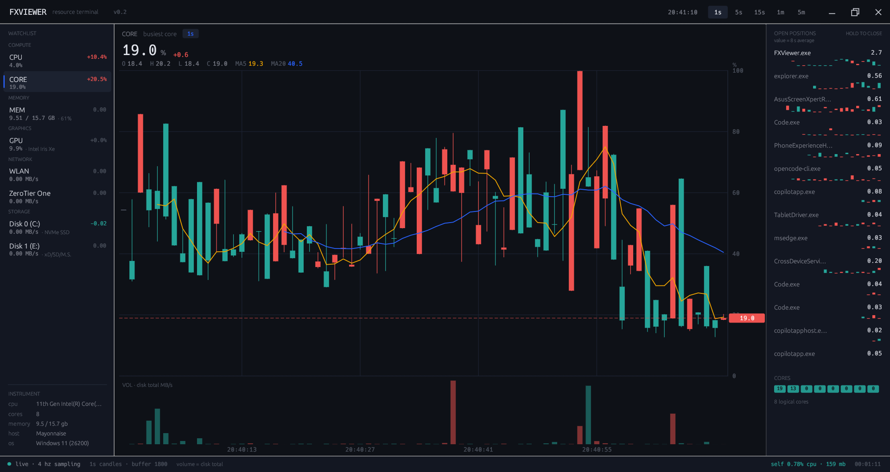

# FXViewer

A resource monitor that reads like an FX trading terminal. CPU, memory, swap,
every disk, every network adapter and every GPU are rendered as their own
candlestick series, so the thing you actually care about — spikes and jitter —
is visible at a glance instead of averaged away.

Built with Rust + egui. One native binary, no webview, no runtime, no database.



```
┌──────────────────────────────────────────────────────────────────────┐
│ FXVIEWER  resource terminal                 live 19:27:04  1s 5s 15s │
├───────────┬──────────────────────────────────────────┬───────────────┤
│ WATCHLIST │  CPU  total utilization            [1s]   │ TOP PROCESSES │
│  CPU      │  42.6%          +1.8                    │ chrome.exe 12 │
│  CORE     │  O 38.0 H 44.0 L 34.0 C 42.0            │ Code.exe  9.8 │
│  MEM      │                                          │ dwm.exe   6.2 │
│  SWAP     │        ╷      ╷                          │ ...           │
│  GPU      │      ┃ ╷ ┃   ┃ ╷  ╷                     ├───────────────┤
│  WLAN     │   ┃  ┃ ┃ ┃ ┃ ┃┃ ┃ ┃                    │ CORES         │
│  C:       │                                          │               │
│ INSTRUMENT│   ┃  ┃ ┃ ┃ ┃ ┃┃ ┃ ┃    ╻               │ ▮▮▮▮▮▮▮▮      │
│  cpu      │  ─┴──┴─┴─┴─┴─┴┴─┴─┴────┴──             │ ▮▮▮▮▮▮▮▮      │
│  cores    │  VOL · network MB/s                      │               │
├───────────┴──────────────────────────────────────────┴───────────────┤
│ ● live · 4 hz sampling   self 0.12% cpu · 38 mb           00:12:07   │
└──────────────────────────────────────────────────────────────────────┘
```

## Why candles

A metric sampled four times a second already has an OHLC shape. Folding those
samples into buckets gives you:

- **body** — where the metric opened and closed during the bucket
- **wick** — how far it spiked or dipped inside the bucket
- **volume bars** — disk throughput during the same bucket, i.e. everything the
  machine read plus everything it wrote, summed over volumes. Throughput
  instruments (a NIC, a disk) already plot their own bytes, so those pages drop
  the volume pane instead of drawing the same series twice

The wick is the whole point. A line chart reporting "CPU averaged 42%" cannot
tell you that it pinned at 96% for 300 ms, which is exactly the event the user
experienced as a stutter.

## Running it

Requirements: Rust (stable) and, on Windows, the MSVC build tools.

```bash
# 1. install Rust once (skip if `cargo --version` already works)
#    Windows: https://win.rustup.rs  |  macOS/Linux: https://sh.rustup.rs

# 2. run
cargo run --release
```

First build pulls ~120 crates and takes a few minutes. Later builds are fast.

To ship a single file:

```bash
cargo build --release
# the binary lands in target/release/fxviewer(.exe)
```

### The binary is self-contained

`.cargo/config.toml` links the C runtime statically (`+crt-static`), so
`target\release\fxviewer.exe` runs on any 64-bit Windows 10/11 machine — no
Visual C++ redistributable, no installer, no side files. Copy the one file and
double-click it.

### Controls

| Action | Result |
| --- | --- |
| Drag the chart | scroll back through history |
| Scroll wheel over the chart | zoom in / out (8 – all candles) |
| Hover | crosshair, per-candle OHLC + MA readout |
| Click a watchlist row | switch the main chart to that series |
| Click a timeframe chip | rebuild the chart at 1s / 5s / 15s / 1m / 5m |
| Click a cell in the CORES grid | pin `CORE` to that logical core; click again to release |
| Drag the top bar | move the window — the native drag loop, so Aero snap works |
| Double-click the top bar | maximize / restore |
| `– □ ✕` in the top bar | minimize / maximize / close (close turns red on hover) |
| Drag a window edge | resize — 5 px invisible border, corners included |
| F11 | borderless fullscreen; F11 again to leave |
| Tray icon, left click (while fullscreen) | toggle fullscreen |
| Tray icon, right click (while fullscreen) | *Fullscreen* / *Quit* |
| Press and hold a position row (0.6 s) | close that process; release early to cancel |

## The ladder follows the instrument

Selecting `MEM` turns the ladder into a memory list: same rows, same hold-to-close
gesture, values in MB and ordered by resident memory. Selecting anything else puts
it back on CPU, as an 8 s average.

Only some instruments have a per-process reading. CPU, memory and GPU do; swap
and every throughput channel are machine-wide figures, so those views keep the
CPU column rather than displaying a column of zeros.

Reading memory for the whole process table is the expensive half of the sampler,
so it only happens while the MEM view is open. Measured over 40 s each on the same
machine:

| View | self CPU, median | max |
| --- | --- | --- |
| CPU | 0.10 % | 1.4 % |
| MEM | 0.25 % | 6.6 % |

So the memory view costs about 2.5× the CPU view, and still under a quarter of one
percent of the machine. Frame rate is unchanged at 4.3 fps.

## Closing a position

A running process is modelled as a **long position**: it holds a share of the
machine and pays out in CPU. The `OPEN POSITIONS` ladder lists the biggest
holders, each with its own candle strip, and closing one is a single gesture —
**press the row and hold for 0.6 s**. A red wash sweeps across the row as you
hold; let go early and nothing happens.

There is deliberately no dialog. A confirmation window costs a round trip to the
centre of the screen and back, which is exactly the wrong shape for something you
do while watching a live chart. Holding in place is both faster and safer than a
click: a stray click cannot kill anything, and an accidental press can be
abandoned by releasing.

The order goes to the sampler thread, which terminates the process
(`TerminateProcess` on Windows, `SIGKILL` elsewhere) and reports the fill back to
the status bar:

```
FILLED   · MsMpEng.exe [6184] · 1.8% released
REJECTED · lsass.exe [812] · system critical
```

Four groups are refused up front, before an order is even sent: this process,
`pid <= 4`, a short list of kernel processes (`smss`, `csrss`, `wininit`,
`winlogon`, `services`, `lsass`, `System`, `Registry`), and the desktop shell
(`explorer.exe`, `dwm.exe`).

The first three matter because terminating them bug-checks the machine rather
than freeing anything. The shell is a different hazard: killing it does not
crash anything, it just takes the taskbar and every icon with it until the shell
is started again — which is alarming, trivially done by accident, and one click
away in Task Manager when it is actually intended.

A denied kill is reported as `access denied` — that is the OS refusing, not the
app. The same request needs an elevated Task Manager, so run this from an
administrator console if you want the same reach.


## Instruments are discovered, not fixed

The watchlist used to be a fixed array of seven symbols, with `NET` and `DISK`
summed across every adapter and every volume. That aggregation is exactly what
Task Manager avoids: a laptop with WLAN and a ZeroTier adapter has two
completely different traffic profiles, and adding them together answers a
question nobody asked.

The sampler now enumerates the hardware every tick and emits one channel per
device:

| Group | Channels |
| --- | --- |
| COMPUTE | `CPU`, `CORE` |
| MEMORY | `MEM`; `COMMIT` and `SWAP` ride under it as sensor panes |
| GRAPHICS | one per adapter |
| NETWORK | one per connected interface, labelled with the Windows adapter name |
| STORAGE | one per mounted volume: `Disk 0 (C:)`, the device's own product string, and its capacity |

Each channel carries a stable id (`net:WLAN`, `disk:C://`, `gpu:0000:00:02.0`),
so candle history follows the device rather than the row index. Plug in a USB
stick and its channel appears; unplug it and the channel disappears, taking its
history with it. Nothing has to be configured, and a machine with three NICs and
two GPUs needs no code change.

A drive letter alone says nothing about what is actually plugged in, so each
volume is identified the way Task Manager identifies it: the physical disk
number and the device's product string, both read with two read-only ioctls
(`IOCTL_STORAGE_GET_DEVICE_NUMBER`, `IOCTL_STORAGE_QUERY_PROPERTY`) on a handle
opened with zero access — no elevation, no WMI, no process spawn, and cached
because the answer only changes when the hardware does. A short product name
("SDHC Card", "xD/SD/M.S.") is shown as-is; a long model number is replaced by
the bus and media type ("NVMe SSD"), and the full string goes in the chart
subtitle together with the capacity.

The watchlist scrolls when the window is too short for the list, and the panel
groups rows by family the way a terminal groups asset classes.

## The side panels are draggable

Both side panels resize by dragging their inner edge (148–340 px on the left,
148–360 px on the right). The maximum follows the window: drag the watchlist
wide on a big screen and then shrink the window, and the panel gives the width
back instead of squeezing the chart out of existence.

Drag a panel below ~48 px and it disappears entirely — a quarter-tile window
can drop both sides and keep only the chart. A collapsed panel leaves a
6x44 px handle on the screen edge where it used to be; drag it (or click it)
and the panel comes back at a usable width. The width lives in app state rather
than egui's `PanelState`, because egui stores the **content** rect and this app
paints rather than lays out, so the content rect was zero and the panel
collapsed to its minimum on the second frame. `ui.set_min_size(rect.size())`
is what makes the width stick.

Everything inside adapts to the dragged width: the second line of a watchlist
row measures the change column and drops the separator, then the note, then
truncates — in that order, so a number that grows a digit cannot make the label
vanish. Headings that would collide (`OPEN POSITIONS` / `HOLD TO CLOSE`) drop
the optional one below 178 px.

## Snapping to a screen quarter

Windows will not snap a window smaller than its minimum tracking size. With a
1240x780 default and a 900x560 floor, a 1080p screen at 125 % scaling could not
be tiled four ways: the quarter is 768x432 points, the floor was taller than
that, and dragging to a corner simply refused.

The floor is now 600x330 points, which is below a quarter on every common
scaling (960x540 at 100 %, 768x432 at 125 %, 640x346 at 150 %). The layout was
checked at each of those sizes:

- side panels narrow from 198/214 to 180/196 px below 880 px of width;
- the machine summary at the bottom of the watchlist is dropped below 520 px of
  height, which is what buys the visible rows back;
- chart time labels space themselves by pixels available instead of a fixed
  count of five, and the crosshair's timestamp suppresses the axis label it
  would otherwise leave a fragment of;
- the OHLC legend drops whole pairs rather than truncating one;
- the status bar gives up its optional left-hand text before it runs into the
  self-cost readout.

Below the floor the chart says "window too small" instead of drawing something
misleading; the panels keep working.

### The chart in a quarter tile

Once the side panels are in, a quarter tile leaves the chart about 412x362
points. At the normal proportions the 80 px legend and the ~62 px volume pane
would eat 40 % of that, which is why the candles looked cramped. Below
620x470 the chart switches to a dense layout:

- the legend drops from 80 to 60 px and the quote from 25 to 20 px, with the
  OHLC row pulled up under it;
- the volume pane steps aside entirely and its height goes to the candles —
  at this size the shape of the price is the whole point, and the pane comes
  back the moment the window is large again;
- the value axis narrows from 66 to 56 px, and the side panels from 198/214 to
  172/184 px.

At 768x432 the candle area grows from about 318x187 to 348x276 points — half
again the height, for the same window.

## The frame is ours

The window is built with `with_decorations(false)`: no native title bar, no
native buttons. The top bar *is* the title bar, the way Task Manager and
VS Code draw theirs — a strip a notch darker than the panels, `FXVIEWER` on
the left, the window buttons flush against the right edge, each a full-height
cell whose hover fills it (red for close). The glyphs are stroked with the
painter rather than set in a font, so they stay crisp at any DPI.

Going undecorated usually costs you two things, and winit's Windows backend
quietly pays for both. It keeps `WS_CAPTION | WS_SIZEBOX` in the window
styles ("required to properly support common window functionality like aero
snap") and eats the non-client area with `WM_NCCALCSIZE` — so the modal
drag loop still exists, Aero snap included. egui reaches it with
`ViewportCommand::StartDrag` when the bar reports `drag_started_by(Primary)`,
and `double_clicked_by` toggles `Maximized`. Resizing has no such freebie —
winit implements no `WM_NCHITTEST` for undecorated windows — so the app
registers eight invisible 5 px `Area`s along the edges and corners, and a
drag on one fires `ViewportCommand::BeginResize(direction)`, which egui-winit
maps to winit's `drag_resize_window` and the same native modal loop. A
hairline outline drawn in a `Foreground` layer replaces the frame the OS
used to paint, so the window still separates from a dark desktop.

While fullscreen, the bar keeps rendering: drag, double-click, maximize and
minimize go dormant (they would fight the viewport state), close still
closes, and the resize borders disappear.

## Fullscreen and the tray

F11 sends egui's `ViewportCommand::Fullscreen`; egui's own viewport state is
the source of truth. There are no toolbar buttons — the header stays clean,
and the only entrance is F11.

Fullscreen covers the taskbar, which strands the exit affordance, so a tray
icon appears while the window is fullscreen and hides again on the way back.
A background thread hosts a hidden message window that owns the icon:
left-clicking toggles fullscreen, the right-click menu offers *Fullscreen*
and *Quit*. The UI learns the host window's handle through a channel and
pokes it with `PostMessage` when fullscreen changes; a failed tray is
survivable, since F11 still exits.

## What "swap" means on Windows, and why it used to sit at zero

Linux swaps anonymous pages to a dedicated partition. Windows has no such
device: it backs committed memory with `C://pagefile.sys`, and the kernel only
writes there when RAM is genuinely tight. That splits one idea into two numbers:

| Reading | What it is | On a healthy 16 GB machine |
| --- | --- | --- |
| `COMMIT` | memory processes have **reserved**, whether or not it is resident | ~10.9 / 17.9 GB, moves all day |
| `SWAP` | bytes that have actually been written to `pagefile.sys` | ~0.06 / 2.2 GB, nearly flat |

The first is the early-warning signal: when commit approaches the limit, the
machine starts paging and everything slows down. The second is the aftermath.

Until 0.2.3 the `SWAP` channel used `sysinfo`'s figure, which is
`CommitTotal − PhysicalTotal`, clamped at zero. On this machine commit is
10.9 GB against 15.7 GB of RAM, so the subtraction is negative and the channel
showed **0.00 GB forever** — arithmetically defensible and useless as an
instrument. It looked broken because it was, in the only sense that matters.

`COMMIT` comes from the PDH counters `\Memory\Committed Bytes` and
`\Memory\Commit Limit`; `SWAP` is `\Paging File(_Total)\% Usage` multiplied by
the page file size Windows reports. Both come from one cached PDH query, one
`PdhCollectQueryData` per tick, and the rows are the same numbers Task Manager
shows under Performance → Memory → Committed. If PDH is unavailable the row
falls back to the old figure rather than disappearing.

## Why a throughput change could read +1000%

Two independent causes, both real:

**Percent change of a near-zero baseline.** The change column was
`(cur - prev) / prev`. For CPU that is sensible. For a NIC idling at 0.04 MB/s,
a completely ordinary burst to 0.5 MB/s is `+1150%` — arithmetically correct and
useless. Rate instruments now quote the **absolute** change in MB/s (`+0.46`),
the way a spread is quoted.

**A sum of cumulative counters.** Throughput is derived by differencing
monotonic byte counters. Summing the counters of *all* devices first and
differencing the sum means any device that appears mid-session injects its
entire lifetime into one tick: plug in a USB stick that has already moved 100 GB
and the sum jumps by 100 GB in 250 ms — 400 GB/s, and four-digit percentages.

The fix is per-device differencing keyed by device id:

- first sighting of a device only seeds the baseline, contributing nothing;
- a counter that goes backwards (re-plug, driver restart, wrap) reseeds and
  reports zero for that tick instead of a negative or absurd rate;
- each device is capped at 10 GB/s, which is above any real link and turns a
  driver glitch into a flat line instead of one candle that squashes the axis.

There is a unit test for each of those three rules.

## Memory is quoted in gigabytes

A percentage is the right unit for CPU: 0–100 % is the whole scale, and the chart
can pin its axis to it. Memory is not like that. On a 16 GB machine the
interesting part of the curve lives between 8 and 12 GB, so a 0–100 % axis
squashes every real move into the middle third of the pane, and a 40 % reading
tells you nothing you can act on.

`MEM` plots **used GB**, with the ceiling carried as metadata; `COMMIT` and
`SWAP` do the same, one pane lower:

- the watchlist row reads `8.88 / 15.7 GB · 57%` — used, total, share;
- the chart headline and the value axis are in GB, with the unit printed above
  the axis;
- the change column quotes the move in GB (`+0.12`), because a percentage of a
  percentage is twice removed from anything you can see in Task Manager.

The total comes from `sysinfo.total_memory()` and is a constant for the session;
only the used figure moves. The axis is not clamped, so it follows the working
set as it drifts. A floor keeps an idle series from magnifying jitter: 0.5 GB for
memory, 0.05 GB for the page file.

## Metric mapping

| Terminal element | Real metric |
| --- | --- |
| `CPU` candles | total CPU utilization |
| `CORE` candles | utilization of the busiest single core, or of one pinned core |
| `MEM` candles | physical memory in use, in GB — the axis follows the range the machine actually occupies instead of pinning 0–100 % |
| `COMMIT` pane | committed memory against the commit limit, in GB — a sensor pane under `MEM` |
| `SWAP` pane | bytes actually in `pagefile.sys`, in GB — a sensor pane under `MEM` |
| NIC candles | one channel per adapter, that adapter's rx+tx (MB/s) |
| Volume candles | one channel per mounted volume, that volume's read + written (MB/s) |
| `GPU` candles | one channel per adapter, that adapter's engine utilization |
| Volume bars | disk throughput during the candle; hidden on NIC and disk pages |
| Sensor strip | under the GPU chart: VRAM use, plus temperature and power when the driver exposes them; under `MEM`: `COMMIT` and `SWAP` |
| `MA5` / `MA20` | 5- and 20-candle moving average of close |
| Process ladder | top processes, ranked and shown by whichever metric the selected instrument uses: CPU share (8 s average) on CPU/CORE/SWAP and throughput channels, resident memory on MEM, GPU engine on GPU |
| Position strip | a 20-candle history of that process, two samples per candle |
| Fill report | status-bar confirmation that a position was closed |
| Core strip | per-logical-core load |
| Status bar | this app's own CPU share and RSS |

Red means the value rose, green means it fell — the convention used on Chinese
markets. Yes, a red CPU candle means the machine got busier. A candle that
closes exactly where it opened is **grey**: a flat bucket is neither up nor
down, and painting it red — which the old `close >= open` test did — turned
every doji into a false buying signal. A quiet GPU at 1 s used to be a wall of
red dashes because of exactly that.

### What the CORE series actually is

Every sample carries one value per logical core. Left unpinned, `CORE` plots the
**maximum across cores at that instant** — a ceiling, not one core's trajectory.
That answers "was there ever a moment when some core was pegged", which is the
signal a single-threaded bottleneck produces. But it cannot tell you *which*
core, and the line can silently hop between cores from sample to sample.

The grid no longer assumes eight columns. It fits as many as the panel allows
(about 23 px per cell), wraps onto as many rows as the core count needs, and
shrinks the cells — never below 8 px tall — before the strip starts eating the
position list. The column count is always a multiple of four, because logic
core counts cluster there: a 32-thread Xeon shows all 32 in 8 columns x 4 rows
at quarter-screen width; a machine with more threads than the panel can
physically hold shows the rest as `N logical cores · M hidden` rather than
silently dropping them. The old `.take(24)` was a hard cap that hid a third of
a 32-thread machine.

Click a cell in the CORES grid to pin a specific core: the legend switches to
`CORE 03`, the last 150 s of that core's raw samples are replayed into the chart
so it is not blank, and from then on the line traces one core only. Click the
same cell again to return to the maximum.

## GPU, and what it costs

`sysinfo` 0.40 ships a GPU backend: DXGI + D3DKMT + PDH on Windows, `IOKit` on
macOS, DRM on Linux. That replaced my plan to hand-roll the PDH counter, and it
also gives a **per-process** GPU column, so the ladder works on the GPU page the
same way it does on CPU and memory.

It is also by far the most expensive thing this program does. One adapter refresh
costs **1.6 ms** of CPU — the DXGI enumeration and the PDH query over every
engine instance — about six times the disk walk. So:

| View | GPU cadence |
| --- | --- |
| On the `GPU` instrument | once a second (every 4th tick) |
| Anywhere else | once every 15 s, just to keep the watchlist row current |

One second is the ceiling the data itself imposes: `sysinfo` reads
`\GPU Engine(*)\Utilization Percentage`, and Windows refreshes those counters
once per second. Polling at the full tick rate would return the same number
four times and cost four times as much.

That resolution is also why **every 1 s GPU candle is a doji** — one distinct
reading per bucket, so open, high, low and close are the same number and the
candle collapses to a one-pixel tick. Widen to 5 s and the bucket collects five
readings, which is why 5 s and above look like proper candles. It is the
instrument's resolution showing through, not a sampling bug.

Everything else runs at the full tick rate. Disk used to be sampled at 1 Hz to
save the volume walk; that left a 1 s candle with exactly one sample, i.e. a
doji on every candle. Measured cost of the walk is **0.29 ms per refresh**, so at
4 Hz it is 0.1 % of one core — cheap enough that the chart wins.

Under the chart sits a strip of sensor panes, because "the GPU is at 40%" is not
the whole story. Each pane is the **same renderer** as the main chart with a
smaller legend, so it keeps the value axis with ticks, the time axis, MA5/MA20,
the last-close line — and the same gestures: wheel to zoom, drag to pan, hover
for the crosshair and its value readout. Each pane has its own `ChartView`, so
zooming one does not move the others or the chart above it. It shares the
chart's background, with a hairline border to separate the panes.

The strip itself is resizable: drag the hairline between chart and panes to
give them more or less height, and drag it all the way down (below ~48 px) to
collapse the strip entirely — the height goes to the chart and a small tab
appears at the bottom centre of the chart to drag it back. On a quarter tile
whether the panes exist at all becomes a choice, not a layout decision.

| Card | Source | Availability |
| --- | --- | --- |
| `VRAM` | NVML on NVIDIA, D3DKMT per adapter otherwise, plus the PDH `GPU Adapter Memory` shared counter | always |
| `TEMP` | NVML | NVIDIA only |
| `POWER` | NVML | NVIDIA only |

The `MEM` page carries `COMMIT` and `SWAP` panes built the same way. Both used
to be watchlist rows; those two numbers move slowly enough that a row is just a
number, while the pane is where the shape lives. The list keeps `MEM` alone.

The VRAM card is the interesting one on a laptop: an integrated GPU has no VRAM
of its own, so `sysinfo` reports the 128 MB dedicated carve-out and it never
moves. The PDH counter set `GPU Adapter Memory` is what Task Manager draws its
"shared GPU memory" bar from, and it is the only way to see the gigabytes an
iGPU actually borrows from RAM.

Temperature and power have no generic Windows API. NVML is loaded at runtime
(`nvml.dll`), so a machine without an NVIDIA driver simply shows the VRAM card
alone — an Intel iGPU exposes neither number to user mode, and the UI says so by
omission rather than by drawing a zero.

Measured self CPU on an 8-core Windows 11 machine: **0.2 % on the CPU page, around
0.5 % while the GPU page is open**. Treat those as order-of-magnitude figures: the
process-CPU counter is derived from 2 s windows, and repeated runs of the same
binary vary by several tenths of a percent. Anything below 0.3 % is inside the
noise.

## How much history

Every timeframe keeps its own ring buffer of 1800 candles. When a new candle
starts, the oldest one is dropped: memory stays flat and the chart never
accumulates, it just slides forward.

| Timeframe | History kept | Default 150-candle view |
| --- | --- | --- |
| 1s | 30 min | 2.5 min |
| 5s | 2.5 h | 12.5 min |
| 15s | 7.5 h | 37 min |
| 1m | 30 h | 2.5 h |
| 5m | 150 h | 12.5 h |

Zooming out is capped at roughly two pixels per candle — past that the wicks
merge into a solid block. To look further back, switch timeframe; that is what
the 1s / 5s / 15s / 1m / 5m chips are for.

A scrolled-back window stays anchored to its candles: when the buffer rolls
over, the offset advances by the number of candles that entered or left, so the
second you are looking at does not slide away to the present.

## Design constraints

- **One sampling thread.** `sysinfo` is beaten on at 4 Hz. Process enumeration is
  the only expensive call: it runs at 0.5 Hz and asks for CPU only, because
  refreshing memory, disk and command line for every process multiplied its cost
  by roughly ten.
- **No polling repaint.** The UI asks for a repaint four times a second, and egui
  composites nothing in between.
- **Bounded memory.** 1800 candles per timeframe per series, held in `VecDeque`s.
  Roughly 400 KB total. Nothing is written to disk.
- **Bounded channel.** The sampler blocks rather than queueing up if the window
  stops draining, so a minimised window costs nothing.
- **Self-reporting.** The status bar shows the app's own CPU and memory. A
  monitor that hides its own cost is not trustworthy.

## Measured cost

Windows 11, 8 logical cores, window at 1240x780, release build:

| | |
| --- | --- |
| Binary | 3.0 MB, single file, no runtime |
| Private memory | 98 MB (working set 149 MB) |
| Idle | 4.3 fps, 0.1 – 0.6 % of total CPU |
| Pointer moving over the chart | up to 50 fps, 2 – 10 % of total CPU |
| Threads | 2 (UI + sampler) |

CPU numbers are shares of total machine capacity, matching Task Manager.

Memory is the one number that missed the original estimate of 40–70 MB: most of
the private footprint is the OpenGL driver's backing store for the window
surface, not application data. The data structures the app actually owns stay
under 1 MB. Still roughly a third of what an Electron build of the same UI
would take, but it is not free.

## Layout

```
src/
├── main.rs       window bootstrap
├── app.rs        panel layout, watchlist, process ladder, status bar
├── chart.rs      candlestick / volume / crosshair painting
├── series.rs     OHLC bucketing and moving averages (+ tests)
├── sampler.rs    background sampling thread
├── win_sensors.rs Windows-only PDH / ioctl / NVML sensors
├── tray.rs       tray icon while fullscreen
├── icon.rs       runtime window icon
├── icon_art.rs   icon pixels, shared with build.rs
├── theme.rs      palette
└── util.rs       formatting helpers
```

The numbers in the table above were measured, not guessed: a throwaway build
printed frame rate and self CPU to stderr every two seconds, and the ladder
shuffle below was measured by dumping every ranking with its
`pid:name:value` rows. Neither instrumentation ships — `cargo test` covers
the logic that survived.

## Why the ladder stopped shuffling

It used to reshuffle on every refresh, and the obvious explanation — processes
starting and stopping — was wrong. Sampling the real process table for 20 s on
an idle machine: 289 processes, **0 spawned, 5 exited**. The set barely moved;
only the ordering did, 9–12 of 14 positions per tick.

The cause was ranking on a single unsmoothed sample. Two rows at 0.10 % and
0.12 % of the machine were compared as if that difference meant something, when
it is measurement noise. `sysinfo` recomputes process CPU from scratch on every
refresh, so nothing damped it.

Two changes:

- **Rank on an 8 s average** (`RANK_ALPHA = 0.25` at a 2 s cadence), and display
  that same average. A list sorted by one number while showing another looks
  broken even when the ordering is right — the first attempt did exactly that,
  and a row reading `0.00%` sat above one reading `1.07%`.
- **Ties keep their previous order** (`RANK_BAND_PCT = 0.4`). Rows within 0.4
  percentage points of the machine are treated as equal, so noise cannot
  reorder them; a process that genuinely climbs still moves up.

Membership is decided on the smoothed value too, which stopped rows on the noise
floor from flickering in and out of the list.

Measured after: **0–1 rows enter or leave per refresh** (was 4–7), and 0–2 rows
move by three or more places (was most of them). Residual ordering inversions
are bounded by the 0.4 pt band, which is 3 % of one core.


## Not in this build

- **CPU temperature / fan speed.** Needs driver-level access; the WMI thermal
  zone is too coarse to be honest about. (GPU temperature is read through NVML
  when an NVIDIA driver is present, and simply absent otherwise.)
- **Autostart, threshold alerts.** Straightforward additions once the chart is
  settled.

## Never, by design

**Nothing in this program acts on its own.** There is no threshold that kills a
process, no stop-loss that fires while the window is minimised. Every
termination starts with a human holding a mouse button down for 0.6 s.

This is a constraint, not a gap:

- **High CPU is usually the payload, not the fault.** A training run, a render or
  a build is supposed to sit at 100% for hours. It fails all three properties an
  automatic rule would look for — highest reading, longest duration, least
  recoverable — so such a rule would kill exactly the work worth protecting.
- **A chart cannot assign blame.** A mining binary and a training job can
  produce indistinguishable curves. Whether a load is acceptable is decided by
  provenance: who launched it, from where, signed or not. None of that is in the
  series.
- **Irreversibility decides who is allowed to act.** Read-only observation and
  alerting may be as theatrical as you like, because nothing happens. Ending a
  process may not, because nothing can be undone.

If automation is ever revisited, the ceiling stays at reversible actions —
lowering the priority of a process you explicitly added. Never terminating one.

## Interface language

Labels are in English on purpose: it matches the terminal aesthetic and keeps the
binary free of an embedded CJK font (5–10 MB). Adding Chinese would mean shipping
a font subset or loading one from the system at runtime.

## Packaging

```bat
cargo build --release
mkdir dist
copy /y target\release\fxviewer.exe dist\FXViewer.exe
powershell -NoProfile -Command "Compress-Archive -LiteralPath 'dist\FXViewer.exe' -DestinationPath 'dist\FXViewer-0.2.12-win64.zip' -Force"
```

```bat
dist\FXViewer.exe              <- single file, send this
dist\FXViewer-0.2.12-win64.zip <- the same exe, zipped for a release upload
```

`FXViewer.exe` **is** the whole program: 3.3 MB, no side files, no config, no
installer. Verified by copying it alone into an empty directory — and into a
path with spaces and CJK characters — and launching it there.

`FXViewer-0.2.12-win64.zip` (1.7 MB) is just the same exe in an archive, ready to
attach to a GitHub Release. Binaries are not committed to the repository:
`dist/` is ignored, so git carries only source and build files.

### File icon and version block

`build.rs` rasterises `src/icon_art.rs` into a 7-size `.ico` (16–256 px; BMP for
the small sizes, PNG above, 37 KB total) and compiles it with the Windows SDK's
`rc.exe` into an `RT_ICON` resource. Without that, Explorer would show a blank
generic sheet — the runtime `with_icon()` call only affects the window, not the
file.

The same resource carries `ProductName` / `FileVersion`, so File Properties and
Task Manager show "FXViewer 0.2.12.0" instead of a bare filename.

The step is optional: on non-Windows hosts, or if `rc.exe` is missing, the build
prints a warning and continues without resources.

### Runtime dependencies

The binary is compiled with `-C target-feature=+crt-static` (see
`.cargo/config.toml`). Without it the exe imports `VCRUNTIME140.dll` and dies on
a machine that never had Visual Studio, which also drags in the UCRT. A quick
check on the shipped binary:

```
vcruntime140   0 hits
msvcp140       0 hits
ucrtbase       0 hits
kernel32       2 hits
opengl32       2 hits
```

Only system DLLs remain, so the recipient needs nothing installed.

**Not done: code signing.** SmartScreen will warn on first launch because the
exe is unsigned; silencing that needs a purchased certificate. The GitHub
release notes explain the "More info → Run anyway" path to recipients.

macOS and Linux builds have to be produced on those systems — eframe links
against platform frameworks and Rust cannot cross-compile a `.app` from Windows.

## Tests

```bash
cargo test
```

Covers bucket rollover, high/low tracking, history bounds and moving averages.

## License

MIT — see [LICENSE](LICENSE).
